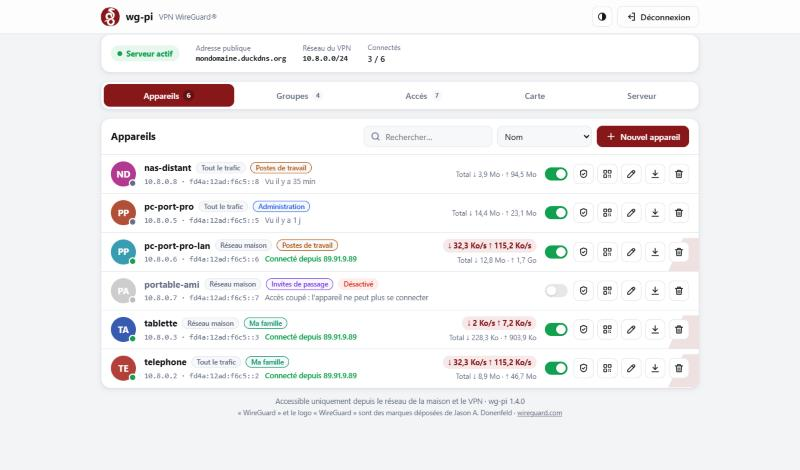
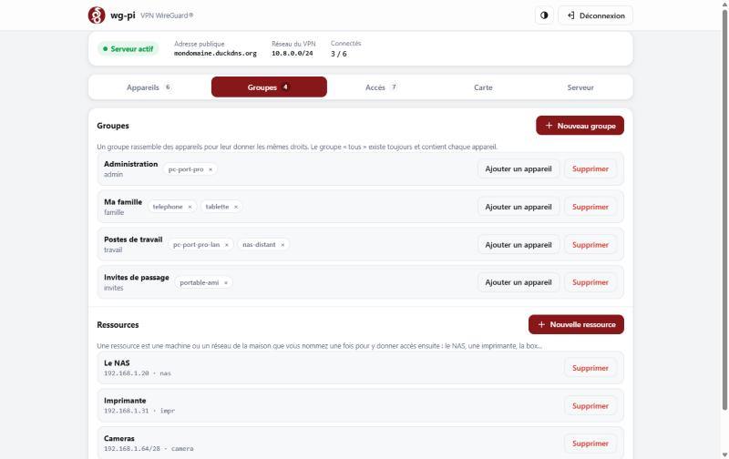
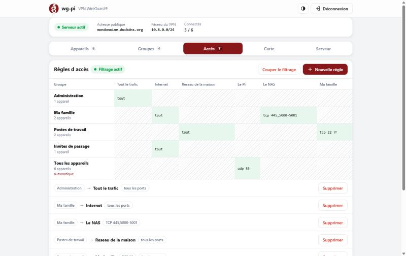
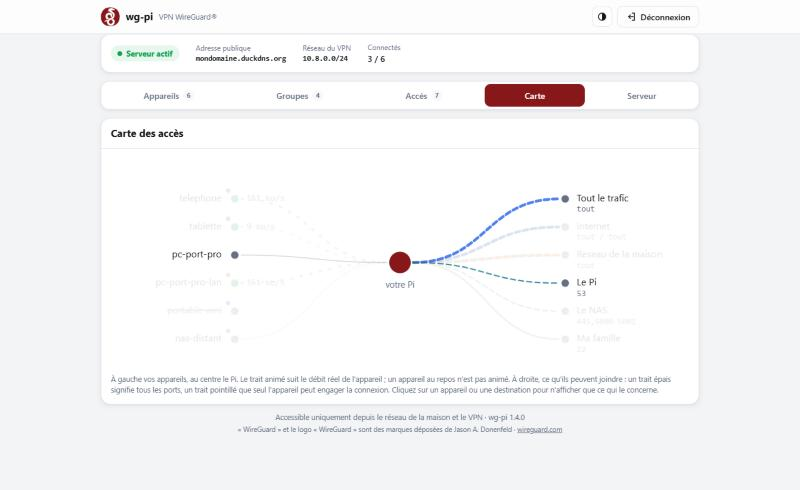

<div align="center">

# WireGuard-RP

**Votre VPN WireGuard à la maison, sur Raspberry Pi, avec une installation entièrement guidée.**

Un seul script en français : il installe tout, crée les QR codes de vos appareils
et vous accompagne jusqu'à l'ouverture du port sur votre box.

[](https://github.com/y0uls/WireGuard-RP/actions/workflows/shellcheck.yml)


[](LICENSE)

```bash
curl -fsSL https://raw.githubusercontent.com/y0uls/WireGuard-RP/main/wg-pi.sh | sudo bash
```



<sub>Le panneau web, servi par le Pi lui-même. Aucun service en ligne, aucun compte.</sub>

</div>

---

## Sommaire

- [Fonctionnalités](#fonctionnalités)
- [Prérequis](#prérequis)
- [Installation](#installation)
- [Aperçu](#aperçu)
- [Utilisation](#utilisation)
- [Interface web](#interface-web)
- [Connecter un appareil](#connecter-un-appareil)
- [Qui peut joindre quoi](#qui-peut-joindre-quoi)
- [Mise à jour](#mise-à-jour)
- [Sauvegarde et restauration](#sauvegarde-et-restauration)
- [Désinstallation](#désinstallation)
- [Dépannage](#dépannage)
- [Comment ça marche](#comment-ça-marche)
- [Pourquoi ce projet](#pourquoi-ce-projet)
- [Contribuer](#contribuer)
- [Licence](#licence)

## Fonctionnalités

- **Installation guidée en 7 étapes**, entièrement en français. Entrée accepte la réponse proposée.
- **Détection automatique** du réseau (adresse du Pi, box, adresse MAC), de l'IP publique et de
  l'opérateur (Orange, Free, SFR, Bouygues) pour adapter les conseils.
- **IP fixe du Pi** : explique comment la réserver dans la box, ou la fixe directement via NetworkManager.
- **DuckDNS intégré** (gratuit) si votre IP publique change : le nom est mis à jour toutes les 5 minutes.
- **Ouverture automatique du port via UPnP**, vérifiée toutes les 30 minutes. Si la box refuse, le
  script affiche le chemin des menus de *votre* box (Freebox, Livebox, box SFR, Bbox) avec les
  valeurs exactes à saisir.
- **QR code** pour chaque appareil, plus un fichier `.conf` et une image `.png` prêts à copier sur un PC.
- **Test en direct** : après l'installation, le script attend que votre téléphone se connecte et
  confirme que tout fonctionne.
- **Deux modes par appareil** : tout le trafic passe par la maison, ou seulement l'accès au réseau
  local (NAS, Home Assistant…).
- **DNS au choix** : box, Cloudflare, Quad9, ou Pi-hole / AdGuard Home s'il est détecté sur le Pi.
- **Commande `wg-pi`** pour gérer les appareils, faire un diagnostic complet, sauvegarder,
  restaurer et se mettre à jour.
- **Interface web moderne** (optionnelle) pour tout gérer depuis un navigateur, téléphone compris :
  débit en direct par appareil, ajout avec QR code, accès coupé ou rétabli d'un clic, renommage,
  téléchargement du fichier `.conf`, suppression.
- **Couper l'accès d'un appareil sans le supprimer** (téléphone perdu, accès prêté à un ami…), puis
  le rétablir sans rien reconfigurer.
- **Groupes et règles d'accès** pour décider qui peut joindre quoi : « les invités n'ont
  qu'Internet », « seule la famille atteint le NAS ». Essai à blanc avant d'appliquer, et
  retour en arrière automatique si vous ne confirmez pas.
- **Compte de consultation** pour l'interface web : un second mot de passe qui permet de
  regarder, pas de modifier.
- **Réglages sûrs par défaut** : clé pré-partagée par appareil, IPv6 sans fuite, compatibilité
  Docker et UFW, mises à jour de sécurité automatiques en option.

## Prérequis

- Un Raspberry Pi sous **Raspberry Pi OS** ou **Debian 11, 12 ou 13** (les dérivés de Debian
  comme Ubuntu devraient fonctionner, sans garantie).
- Un accès SSH (ou un écran et un clavier) avec un compte qui peut utiliser `sudo`.
- Le Pi branché à la box, de préférence **en Ethernet**.
- L'accès à l'interface d'administration de la box.
- Une **IPv4 publique** : pas de CGNAT (voir [Dépannage](#dépannage)).

## Installation

Sur le Raspberry Pi, une seule commande :

```bash
curl -fsSL https://raw.githubusercontent.com/y0uls/WireGuard-RP/main/wg-pi.sh | sudo bash
```

Ou, si vous préférez lire le script avant de le lancer :

```bash
curl -O https://raw.githubusercontent.com/y0uls/WireGuard-RP/main/wg-pi.sh
chmod +x wg-pi.sh
sudo ./wg-pi.sh
```

<details>
<summary>Pas de <code>curl</code> (Debian minimale) ? Avec <code>wget</code></summary>

En une ligne :

```bash
wget -qO- https://raw.githubusercontent.com/y0uls/WireGuard-RP/main/wg-pi.sh | sudo bash
```

Ou en téléchargeant d'abord le script :

```bash
wget -O wg-pi.sh https://raw.githubusercontent.com/y0uls/WireGuard-RP/main/wg-pi.sh
chmod +x wg-pi.sh
sudo ./wg-pi.sh
```

</details>

L'assistant se déroule en 7 étapes :

| Étape | Ce qui se passe |
|:-:|---|
| 1 | Vérification du système et installation des paquets (`wireguard-tools`, `qrencode`, `iptables`…) |
| 2 | Détection du réseau local et choix pour garder une IP fixe au Pi |
| 3 | Adresse publique : IP, nom DuckDNS ou votre propre nom de domaine |
| 4 | Réglages du VPN : DNS, mode de routage, port, UPnP, mises à jour automatiques, puis récapitulatif |
| 5 | Génération des clés, configuration, pare-feu, démarrage du service |
| 6 | Ouverture du port sur la box (automatique ou guidée) |
| 7 | Création du premier appareil, QR code et test de connexion en direct |

**Ce qu'il vous reste à faire :**

1. Ouvrir le port UDP sur la box, si l'UPnP n'a pas fonctionné. Le script vous dit où cliquer.
2. Réserver l'adresse du Pi dans la box. Le script vous donne l'adresse MAC.
3. Installer l'application **WireGuard** sur le téléphone, scanner le QR code, **couper le Wi-Fi**
   et activer le tunnel.

<details>
<summary>Installation sans aucune question</summary>

Toutes les réponses par défaut sont acceptées. L'adresse publique est votre IP actuelle, sauf si
vous en précisez une avec `--endpoint`. DuckDNS ne peut pas être configuré dans ce mode.

```bash
curl -fsSL https://raw.githubusercontent.com/y0uls/WireGuard-RP/main/wg-pi.sh | sudo bash -s -- install --yes --client telephone
```

| Option | Rôle |
|---|---|
| `--yes` | accepter toutes les réponses par défaut |
| `--endpoint <adresse>` | IP publique ou nom de domaine utilisé par les appareils |
| `--port <port>` | port UDP du VPN (par défaut `51820`) |
| `--client <nom>` | nom du premier appareil (par défaut `telephone`) |

</details>

## Aperçu

Exemple avec une Livebox (extraits) :

```text
━━━━ Étape 3/7 — Comment vos appareils trouveront votre maison ━━━━

➜ Recherche de votre adresse IP publique…
   IP publique            86.xxx.xxx.xxx
   Opérateur              Orange / Sosh

Chez Orange, l'IP publique change de temps en temps (redémarrage de la Livebox…).
→ Un nom gratuit DuckDNS évite que le VPN tombe en panne ce jour-là.

? Quelle adresse vos appareils doivent-ils utiliser pour joindre la maison ?
    1) Mon IP publique (86.xxx.xxx.xxx)
    2) Un nom gratuit DuckDNS (xxx.duckdns.org) mis à jour automatiquement — je vous guide
    3) J'ai déjà un nom de domaine / DynDNS (xxxx.freeboxos.fr, No-IP…)
?   Votre choix [2]
```

```text
━━━━ Étape 6/7 — Ouvrir le port sur votre box ━━━━

Connectez-vous à votre Livebox depuis un appareil de la maison :
   http://192.168.1.1 (identifiant « admin », mot de passe sur l'étiquette de la box)

① Ouvrir le port du VPN — Paramètres avancés › Réseau › NAT/PAT (règle personnalisée)
   Nom / application      WireGuard
   Protocole              UDP (pas TCP)
   Port externe           51820
   Port interne           51820
   Appareil / IP          192.168.1.50 (raspberrypi)

② Réserver l'adresse du Pi — Paramètres avancés › Réseau › DHCP › Baux DHCP statiques
   Appareil (adresse MAC) dc:a6:32:xx:xx:xx (raspberrypi)
   Adresse IP             192.168.1.50
```

```text
$ sudo wg-pi list

  Serveur : ● actif — chezmoi-vpn.duckdns.org:51820 — réseau 10.8.0.0/24

  APPAREIL         IP VPN        REÇU      ENVOYÉ     DERNIÈRE CONNEXION
  telephone        10.8.0.2      2.2Mo     18Mo       ● connecté (37.xxx.xxx.xxx:51023)
  pc-portable      10.8.0.3      0o        0o         jamais

➜ 2 appareil(s), dont 1 connecté(s) en ce moment.
```

```text
$ sudo wg-pi access show

━━━━ Accès ━━━━

✔ Filtrage actif : seul ce qui est autorisé ci-dessous passe.

Groupe « Ma famille » (famille)
   appareils       pc-portable telephone
   peut joindre    Internet (tous protocoles)
                   Le réseau de la maison (192.168.1.0/24) (tous protocoles)
                   Le NAS (192.168.1.20) (tcp 445, 5000-5001)

Groupe « Invités » (invites)
   appareils       tablette-amis
   peut joindre    Internet (tous protocoles)

Groupe « Tous les appareils » (tous, automatique)
   appareils       telephone pc-portable tablette-amis
   peut joindre    rien : aucune règle ne concerne ce groupe

Ports en écoute sur le Pi (joignables depuis le VPN) : 22 443 51820
   Un service publié sur toutes les interfaces, par exemple un conteneur Docker,
   est atteignable par chacun de vos appareils du VPN.
```

## Utilisation

Une fois l'installation terminée, tout se gère avec la commande `wg-pi` :

| Commande | Rôle |
|---|---|
| `sudo wg-pi` | menu interactif |
| `sudo wg-pi add [nom] [--split\|--full]` | ajouter un appareil et afficher son QR code |
| `sudo wg-pi remove [nom]` | supprimer un appareil |
| `sudo wg-pi disable [nom]` | couper l'accès d'un appareil sans le supprimer |
| `sudo wg-pi enable [nom]` | rétablir l'accès d'un appareil |
| `sudo wg-pi rename [nom] [nouveau]` | renommer un appareil (rien à changer sur l'appareil) |
| `sudo wg-pi list` | appareils, trafic, groupes et état des connexions |
| `sudo wg-pi qr [nom]` | réafficher le QR code d'un appareil |
| `sudo wg-pi check` | diagnostic complet |
| `sudo wg-pi box` | rappel de la configuration de la box |
| `sudo wg-pi upnp` · `on` · `off` | ouverture du port : automatique (UPnP) ou à la main |
| `sudo wg-pi endpoint [adresse]` | changer l'adresse publique : sans adresse, menu (IP, DuckDNS, nom de domaine) ; avec une adresse, IP ou nom fixe |
| `sudo wg-pi backup` | sauvegarder la configuration, clés comprises |
| `sudo wg-pi restore <fichier>` | restaurer une sauvegarde |
| `sudo wg-pi web [off\|password\|port N]` | activer ou désactiver l'interface web, changer son mot de passe ou son port |
| `sudo wg-pi web lecture-seule [off]` | second mot de passe qui permet de regarder, pas de modifier |
| `sudo wg-pi group …` | groupes d'appareils — voir [Qui peut joindre quoi](#qui-peut-joindre-quoi) |
| `sudo wg-pi resource …` | appareils de la maison que vos règles peuvent citer |
| `sudo wg-pi access …` | règles d'accès : qui peut joindre quoi, sur quels ports |
| `sudo wg-pi update` | mettre à jour wg-pi depuis ce dépôt |
| `sudo wg-pi uninstall` | tout désinstaller |
| `sudo wg-pi help` | aide complète |

Sans nom, `remove` et `qr` vous proposent la liste des appareils, et `add` vous demande le nom.
Un nom fait de 1 à 15 caractères parmi lettres, chiffres, `-` et `_`.

Sans option, un nouvel appareil utilise le mode choisi à l'installation.

```bash
sudo wg-pi add tablette           # mode choisi à l'installation
sudo wg-pi add pc-portable --full # tout le trafic passe par la maison
sudo wg-pi add nas-acces --split  # seulement l'accès au réseau de la maison
```

`--yes` confirme automatiquement `remove` et `uninstall`, ce qui est pratique dans un script.

## Interface web

Tout ce que fait la commande `wg-pi` est aussi possible depuis un navigateur, sur un
ordinateur ou sur le téléphone. Le panneau est rangé en cinq onglets.

**Appareils** — chacun sur une ligne : qui est connecté (point vert), d'où, depuis quand,
**débit en direct** (↓ ↑) sur fond de sa courbe, totaux échangés. Un interrupteur coupe ou
rétablit son accès sans le supprimer ; un bouton ouvre sa **fiche d'accès** — ce qu'il peut
joindre, ce qui peut le joindre, sur quels ports, la réponse directe à « qu'est-ce que la
tablette des enfants peut atteindre ? ». Nouvel appareil en deux clics avec son **QR code**
affiché aussitôt, téléchargement du `.conf` sans passer par `scp`, renommage, suppression,
recherche et tri.

**Groupes** — créez un groupe, mettez-y des appareils, retirez-les d'un clic. Déclarez aussi
vos **ressources** : le NAS, une imprimante, la box… nommées une fois pour leur donner accès
ensuite.



**Accès** — le tableau de ce que chaque groupe peut joindre et sur quels ports, les cases
hachurées signalant ce qui n'est pas autorisé ; la liste des règles une par une, avec leur
suppression ; et le bouton qui **active ou coupe le filtrage**, avec le même filet de
sécurité qu'en ligne de commande (voir [Qui peut joindre quoi](#qui-peut-joindre-quoi)).



**Carte** — vos appareils à gauche, le Pi au centre, ce qu'ils peuvent joindre à droite. Le
trait reliant chaque appareil au Pi **s'anime au rythme de son débit réel**. Un clic sur un
appareil ou une destination n'affiche plus que ce qui le concerne — le tracé traverse le Pi
et continue jusqu'aux destinations autorisées, pour répondre à « et ensuite, qu'est-ce qu'il
atteint ? ».



**Serveur** — la clé publique (copiable), le port, le DNS, l'IPv6, le keepalive, le réseau de
la maison, la version. L'essentiel — adresse publique, réseau du VPN, appareils connectés —
reste affiché en permanence au-dessus des onglets.

Thème clair, sombre ou automatique, affichage adapté au téléphone.

Pour l'activer, y compris sur une installation existante après `sudo wg-pi update` :

```bash
sudo wg-pi web
```

Choisissez un mot de passe (8 caractères minimum), puis ouvrez l'adresse affichée :

- `https://<adresse du Pi>`, ou `https://raspberrypi.local` avec le nom de votre Pi ;
- depuis l'extérieur, en passant par le VPN : `https://10.8.0.1`.

Le panneau utilise le port HTTPS standard (443) s'il est libre. Si un autre programme l'occupe
déjà (Pi-hole v6, serveur web…), il prend automatiquement le port 51821, et l'adresse devient
`https://<adresse du Pi>:51821`. Pour changer de port à tout moment, par exemple
`sudo wg-pi web port 443`.

> [!NOTE]
> La première fois, le navigateur affiche un avertissement de sécurité. C'est normal : le
> certificat HTTPS a été créé par le Pi lui-même. Choisissez **Paramètres avancés** puis
> **Continuer vers le site**.

**Sécurité**
- Le panneau n'accepte que le réseau de la maison et le VPN : **il n'y a rien à ouvrir sur la box,
  et il ne faut surtout pas le faire**.
- Il est servi en HTTPS et protégé par un mot de passe stocké haché. Les sessions sont protégées
  contre le CSRF, et l'accès est bloqué 5 minutes après 5 essais ratés.
- Il ne fait qu'appeler la commande `wg-pi` : le terminal et le navigateur voient toujours les mêmes
  appareils.
- Il ne demande que Python, déjà présent sur Raspberry Pi OS, sans Docker ni dépendance à
  télécharger.

| Commande | Rôle |
|---|---|
| `sudo wg-pi web` | activer (ou réafficher l'adresse) |
| `sudo wg-pi web password` | changer le mot de passe (déconnecte les sessions ouvertes) |
| `sudo wg-pi web port <numéro>` | changer de port (retour automatique à l'ancien en cas d'échec) |
| `sudo wg-pi web lecture-seule` | créer un compte de consultation (voir ci-dessous) |
| `sudo wg-pi web lecture-seule off` | le supprimer |
| `sudo wg-pi web off` | désactiver |

**Un compte pour regarder sans toucher**

`sudo wg-pi web lecture-seule` crée un **second mot de passe**. Qui s'en sert voit tout —
les appareils, les débits, les accès — mais ne peut rien modifier : ni ajouter ou supprimer
un appareil, ni couper un accès. Les fichiers `.conf` et les QR codes ne sont pas non plus
téléchargeables, car ils contiennent la clé privée de l'appareil. Pratique pour montrer
l'installation, ou pour que quelqu'un vérifie que le VPN tourne sans pouvoir y toucher.

Le mot de passe doit être différent de celui de l'administrateur : wg-pi refuse de
l'enregistrer sinon, car il donnerait l'accès complet sans le dire.

## Connecter un appareil

**Téléphone ou tablette** : installez l'application WireGuard
([Android](https://play.google.com/store/apps/details?id=com.wireguard.android) /
[iOS](https://apps.apple.com/app/wireguard/id1441195209)), puis **+** › **Scanner un code QR**.

**Ordinateur** : la configuration est copiée dans `~/wireguard-clients/` sur le Pi. Récupérez-la
en tapant la commande **sur l'ordinateur**, pas sur le Pi. Le script l'affiche avec votre
utilisateur et l'adresse du Pi.

Windows (PowerShell), le fichier arrive dans Téléchargements :

```bash
scp utilisateur@192.168.1.50:wireguard-clients/pc-portable.conf $HOME\Downloads\
```

Mac / Linux, le fichier arrive dans le dossier personnel :

```bash
scp utilisateur@192.168.1.50:wireguard-clients/pc-portable.conf ~/
```

La première fois, répondez `yes` (en entier) à la question sur l'empreinte du Pi, puis tapez le
mot de passe de votre utilisateur sur le Pi. Importez ensuite le fichier dans l'application
[WireGuard](https://www.wireguard.com/install/) avec **Importer un tunnel depuis un fichier**, et
supprimez-le de l'ordinateur une fois importé : il contient la clé privée de l'appareil.

> [!IMPORTANT]
> Pour tester, utilisez la **4G/5G** et non le Wi-Fi de la maison : beaucoup de box ne savent pas
> renvoyer vers elles-mêmes une connexion qui part de chez vous.

## Qui peut joindre quoi

Par défaut, un appareil connecté au VPN atteint **tout** : le réseau de la maison, le Pi
lui-même et Internet. C'est simple, et c'est souvent ce qu'on veut. Mais si vous prêtez un
accès à un ami, ou si la tablette des enfants est sur le VPN, vous préférerez sans doute
qu'ils n'atteignent pas le NAS.

L'idée tient en trois mots : des **groupes** d'appareils, des **ressources** de la maison,
et des **règles** qui disent qui peut joindre quoi.

Tout ce qui suit se fait **aussi depuis le panneau web**, dans les onglets « Groupes » et
« Accès » : créer un groupe, y mettre des appareils, déclarer une ressource, ajouter ou
supprimer une règle, activer ou couper le filtrage. Les commandes restent utiles pour aller
vite, ou quand le panneau n'est pas installé.

Les règles portent sur ce qui **traverse** le Pi : le réseau de la maison, Internet, les
autres appareils du VPN. Ce qui tourne **sur** le Pi — SSH, le panneau web, Pi-hole, un
conteneur Docker — reste joignable par tous vos appareils du VPN, quelles que soient vos
règles.

### Un exemple complet

```bash
sudo wg-pi group add invites --libelle="Invités"
sudo wg-pi group add famille --libelle="Ma famille"
sudo wg-pi group join tablette-amis invites
sudo wg-pi group join telephone famille

sudo wg-pi resource add nas 192.168.1.20 --libelle="Le NAS"

sudo wg-pi access allow invites internet                        # les invités : Internet seulement
sudo wg-pi access allow famille maison                          # la famille : tout le réseau
sudo wg-pi access allow famille res:nas --proto=tcp --ports=445 # et les partages du NAS

# Ajouter un port à une règle existante, sans retaper la liste.
# « sudo wg-pi access list » donne les identifiants.
sudo wg-pi access set p3 --ports=445,139

# Une machine a changé d adresse : toutes les règles qui la citent suivent.
sudo wg-pi resource add nas 192.168.1.25
```

> [!IMPORTANT]
> Si vos appareils utilisent le **DNS de votre box** — c'est ce qui est proposé par défaut à
> l'installation — la règle « Internet seulement » le refuse aussi, car la box fait partie du
> réseau de la maison. Les invités auraient Internet, mais plus aucun nom de site ne se
> résoudrait. Autorisez-leur le DNS :
>
> ```bash
> sudo wg-pi resource add dns 192.168.1.1 --libelle="Le DNS de la box"
> sudo wg-pi access allow invites res:dns --proto=udp --ports=53
> sudo wg-pi access allow invites res:dns --proto=tcp --ports=53
> ```
>
> en remplaçant `192.168.1.1` par l'adresse de votre box. Avec un DNS public (Cloudflare,
> Quad9) ou un Pi-hole sur le Pi, il n'y a rien à faire. `wg-pi access on` vous prévient de
> toute façon si une de vos règles tombe dans ce piège.

Puis, pour voir le résultat avant d'y toucher :

```bash
sudo wg-pi access show
```

Rien n'est encore appliqué à ce stade : les groupes et les règles sont enregistrés, mais le
trafic n'est pas filtré. C'est volontaire, vous pouvez tout préparer tranquillement.

### Activer, et le filet de sécurité

`access plan` affiche les autorisations telles qu'elles seront posées, et ne change rien :

```bash
sudo wg-pi access plan
```

Relisez la liste. Si un appareil qui vous sert tous les jours n'y apparaît nulle part, c'est
qu'il n'est dans aucun groupe autorisé : corrigez avant d'aller plus loin.

> [!NOTE]
> `access on` refuse de s'activer tant qu'aucune règle n'est enregistrée : le filtrage ne
> laisse passer que ce qui est autorisé, il couperait donc tout. Posez d'abord une base
> large, puis resserrez :
>
> ```bash
> sudo wg-pi access allow tous internet
> sudo wg-pi access allow tous maison
> ```

Quand la liste vous convient, activez — de préférence avec le Pi à portée de main, pas à
distance pendant les vacances :

```bash
sudo wg-pi access on
```

> [!IMPORTANT]
> Après `access on`, vous avez **deux minutes** pour confirmer. Sans confirmation, tout
> revient automatiquement à l'état précédent. Vérifiez donc tout de suite que vos appareils
> fonctionnent encore, puis lancez `sudo wg-pi access confirm`. Si quelque chose ne va plus,
> `sudo wg-pi access off` — ou ne faites rien et attendez.

Le SSH **vers le Pi** est accepté quoi qu'il arrive, et aucune règle ne peut le retirer :
vous ne pouvez pas vous enfermer dehors avec une règle maladroite. Le SSH vers un autre
appareil de la maison, lui, dépend de vos règles comme le reste.

Tant que vous n'avez pas confirmé, le filet reste tendu : il se remet en place même après un
redémarrage du Pi, parce que le premier réflexe quand on se coupe l'accès est justement de
redémarrer. Une fois `access confirm` passé, c'est réglé pour de bon et vous n'avez plus à y
penser.

### Les commandes

| Commande | Rôle |
|---|---|
| `sudo wg-pi group list` | les groupes et ce qu'ils contiennent |
| `sudo wg-pi group add <nom> [--libelle="…"]` | créer un groupe |
| `sudo wg-pi group rm <nom>` | supprimer un groupe |
| `sudo wg-pi group join <appareil> <groupe>` | mettre un appareil dans un groupe |
| `sudo wg-pi group leave <appareil> <groupe>` | l'en retirer |
| `sudo wg-pi group set <appareil> <g1,g2,…>` | fixer d'un coup la liste de ses groupes |
| `sudo wg-pi resource add <nom> <ip\|réseau> [--libelle="…"]` | déclarer un appareil de la maison, ou changer son adresse |
| `sudo wg-pi resource list` · `resource rm <nom>` | lister, supprimer |
| `sudo wg-pi access show` | ce que chaque groupe peut joindre |
| `sudo wg-pi access list` | les règles, une par une |
| `sudo wg-pi access allow <groupe> <destination> [options]` | autoriser un accès |
| `sudo wg-pi access set <id> [options]` | modifier une règle sans la ressaisir |
| `sudo wg-pi access rm <id>` | supprimer une règle |
| `sudo wg-pi access plan` | essai à blanc, sans rien appliquer |
| `sudo wg-pi access on` · `confirm` · `off` | activer, confirmer, désactiver |
| `sudo wg-pi access check` | vérifier la cohérence |

Les destinations possibles :

| Destination | Ce qu elle couvre |
|---|---|
| `tout` | **Tout le trafic** : Internet, la maison, le Pi, et les autres appareils du VPN |
| `internet` | Internet seulement — ni la maison, ni les autres appareils |
| `maison` | le réseau de la maison |
| `pi` | les services du Pi lui-même |
| `res:<ressource>` | une machine ou un réseau que vous avez nommé |
| `grp:<groupe>` | les appareils d un groupe, pour qu ils se joignent entre eux |

`tout` est le raccourci d un groupe d administration : une seule règle, qui reste juste
quand vous ajoutez un groupe plus tard. Sans elle, il en faudrait quatre, et une de plus
à chaque nouveau groupe.

```bash
sudo wg-pi group add admin --libelle="Administration"
```

```bash
sudo wg-pi group join mon-portable admin
```

```bash
sudo wg-pi access allow admin tout
```

| Option de `access allow` | Rôle |
|---|---|
| `--proto=tcp` · `udp` · `icmp` · `any` | le protocole ; `any` par défaut, c'est-à-dire tous |
| `--ports=445,5000-5001` | les ports, uniquement avec `--proto=tcp` ou `--proto=udp` ; au plus 15 ports, une plage en comptant deux |
| `--sens=deux` | les deux appareils peuvent engager la connexion — **uniquement** vers un `grp:`, voir ci-dessous |
| `--libelle="…"` | un intitulé lisible, affiché dans les listes et le panneau web |

Par défaut, seule la source engage la connexion : les réponses reviennent, mais la
destination ne peut rien initier. `--sens=deux` lève cette restriction, et n'est accepté
que vers un groupe : vers Internet, la maison ou une ressource, le trafic qui revient ne
passe pas par le VPN et dépend de votre box, donc wg-pi ne peut rien en promettre.

Le groupe **`tous`** existe toujours et contient automatiquement tous vos appareils, y
compris ceux que vous ajouterez demain. Une règle **autorise**, jamais n'interdit : il n'y
a donc ni ordre, ni priorité, rien à déboguer en cascade.

> [!NOTE]
> À retenir : vos appareils continuent de **voir** toute la plage du VPN, c'est normal. Ils
> peuvent *essayer* de joindre ce qui est interdit, et le Pi refuse immédiatement —
> « connexion refusée », sans attente. Modifier le fichier de configuration sur l'appareil
> ne donne aucun accès supplémentaire.

<details>
<summary><b>Deux limites à connaître</b></summary>

**Le Pi lui-même reste joignable.** Vos règles ne protègent pas les services qui tournent
sur le Pi : SSH, le panneau web, Pi-hole, un conteneur Docker publié sur toutes les
interfaces. Tous vos appareils du VPN les atteignent, même ceux qui n'ont aucune règle vers
`pi` — une règle `access allow <groupe> pi` **ouvre** un accès, elle n'en ferme aucun.
`sudo wg-pi access show` liste les ports en écoute sur le Pi pour que vous sachiez de quoi
on parle. Si l'un de ces services doit rester privé, réglez-le dans le service lui-même, ou
avec UFW.

**L'IPv6.** Le moteur ne sait filtrer que l'IPv4. Tant que le filtrage est actif, **l'IPv6
ne traverse donc pas le VPN** : elle est refusée dans les deux sens sur `wg0`. Sans cela vos
règles seraient contournables — deux appareils se joindraient par leur adresse IPv6 du
tunnel sans que rien ne l'examine.

Tout l'IPv4 continue de fonctionner normalement, et `sudo wg-pi access off` rétablit l'IPv6
immédiatement. En pratique, chez un particulier, à peu près tout reste joignable en IPv4 ;
une promesse de cloisonnement tenue vaut mieux qu'une promesse complète et fausse.

</details>

## Mise à jour

```bash
sudo wg-pi update
```

La dernière version est téléchargée depuis ce dépôt, directement par le dernier commit (sans
attendre le cache de GitHub), puis vérifiée avant de remplacer la commande. Vos réglages et vos
appareils ne changent pas, et une version plus ancienne n'est jamais installée à la place.

## Sauvegarde et restauration

Les cartes SD finissent par s'user : faites une sauvegarde de temps en temps.

```bash
sudo wg-pi backup
```

Le fichier `wg-pi-sauvegarde-AAAAMMJJ-HHMMSS.tar.gz` est créé dans votre dossier personnel, et le
script affiche la commande `scp` pour le copier sur votre ordinateur. Faites-le : une sauvegarde
restée sur la carte SD disparaît avec elle. Elle contient les clés du VPN, gardez-la en lieu sûr.

Pour tout retrouver sur un Pi neuf, copiez-y la sauvegarde puis lancez, depuis le dossier où elle
se trouve :

```bash
curl -fsSL https://raw.githubusercontent.com/y0uls/WireGuard-RP/main/wg-pi.sh | sudo bash -s -- restore wg-pi-sauvegarde-AAAAMMJJ-HHMMSS.tar.gz
```

Vos appareils se reconnectent sans rien changer. Si l'adresse du Pi a changé, le script vous
prévient qu'il faut mettre à jour la redirection de port.

## Désinstallation

```bash
sudo wg-pi uninstall
```

Le script propose une sauvegarde, puis supprime le service, la configuration (copies de
`~/wireguard-clients` comprises) et les tâches DuckDNS/UPnP. Il retire aussi la redirection UPnP
et la règle UFW si elles existent.

Restent en place : les paquets installés, les mises à jour de sécurité automatiques et l'IP fixe
du Pi si vous l'aviez fixée via NetworkManager. Pensez à supprimer la redirection de port sur la
box si vous l'aviez faite à la main.

## Dépannage

Commencez toujours par :

```bash
sudo wg-pi check
```

Le diagnostic vérifie le service, le port, le routage, le NAT, l'adresse du Pi, l'IP publique,
DuckDNS, UPnP et UFW. Si tout est vert et que ça ne marche pas, c'est presque toujours la
**redirection de port sur la box** : protocole UDP, bon port, bonne IP du Pi.

<details>
<summary><b>Le téléphone ne se connecte pas</b></summary>

- Testez en **4G/5G**, Wi-Fi coupé.
- Vérifiez la redirection sur la box : **UDP** (pas TCP), port `51820` (ou celui choisi), vers l'IP du Pi.
- Vérifiez que l'adresse publique est à jour : `sudo wg-pi check` compare l'adresse utilisée par
  les appareils à votre IP publique actuelle.

</details>

<details>
<summary><b>« Redirection UPnP introuvable » alors que l UPnP est activé sur ma box</b></summary>

Les box distinguent deux options que leur interface appelle toutes les deux « UPnP » :
le **partage multimédia UPnP/DLNA**, qui diffuse vos photos et vos vidéos, et l **UPnP IGD**,
le seul qui autorise un appareil à ouvrir un port. Sur Livebox, voir le premier coché ne dit
rien du second.

Pour savoir lequel vous avez :

```bash
sudo wg-pi upnp
```

- **« aucune réponse »** : aucun appareil UPnP sur le réseau, ou le Pi interroge la mauvaise
  interface.
- **« des appareils UPnP répondent, mais pas de passerelle »** : c est le cas ci-dessus.
  Activez l UPnP IGD dans la box, ou ouvrez le port à la main.

Si votre box ne sait pas faire d UPnP IGD — ou si vous préférez garder la main — ouvrez le
port vous-même avec `sudo wg-pi box`, puis dites-le à wg-pi pour qu il cesse de vous avertir :

```bash
sudo wg-pi upnp off
```

Le port reste ouvert : seule l ouverture **automatique** est désactivée.
</details>

<details>
<summary><b>Free : la redirection ne marche pas</b></summary>

Sur les lignes Free récentes, l'IPv4 peut être **partagée** : seule une plage de ports est alors
redirigeable. Demandez l'« IP fixe V4 full-stack » (gratuite) dans votre espace abonné, puis
redémarrez la Freebox.

</details>

<details>
<summary><b>Box 4G/5G, Starlink… (CGNAT)</b></summary>

L'opérateur partage la même IP publique entre plusieurs clients : aucune redirection de port n'est
possible. Il faut lui demander une IPv4 publique. Le script détecte ce cas quand la box répond en UPnP.

</details>

<details>
<summary><b>Mon IP publique a changé</b></summary>

```bash
sudo wg-pi endpoint
```

Choisissez la nouvelle adresse, idéalement un nom DuckDNS pour ne plus y penser, puis réimportez
les QR codes sur les appareils (`sudo wg-pi qr <nom>`).

</details>

<details>
<summary><b>L'adresse du Pi a changé</b></summary>

`sudo wg-pi check` le signale. Lancez `sudo wg-pi box` : il enregistre la nouvelle adresse et
affiche la redirection à corriger sur la box. Réservez ensuite l'adresse du Pi dans le DHCP de la
box pour que ça ne se reproduise pas.

</details>

<details>
<summary><b>Je n'accède pas à certains appareils là où je me trouve</b></summary>

En France, beaucoup de box utilisent la même plage `192.168.1.x`. En mode `--split`, si le réseau
où vous êtes utilise la même plage que chez vous, ses appareils peuvent devenir injoignables tant
que le VPN est actif. C'est une limite commune à tous les VPN.

</details>

<details>
<summary><b>J'ai activé le filtrage et un appareil ne passe plus</b></summary>

Le plus simple, et sans risque :

```bash
sudo wg-pi access off
```

Vos groupes et vos règles sont conservés, seul le filtrage s'arrête. Regardez ensuite ce
qui manquait avec `sudo wg-pi access show` : un appareil n'atteint que ce que ses groupes
autorisent, et un appareil dans aucun groupe nommé ne dépend que des règles portant sur
`tous`.

Si vous veniez d'activer et que vous n'avez pas confirmé, il n'y a rien à faire : tout
revient de lui-même au bout de deux minutes.

Pour voir ce que le Pi a refusé :

```bash
sudo journalctl -k | grep wg-pi-refus
```

</details>

<details>
<summary><b>Le panneau web affiche « Règles non appliquées » en rouge</b></summary>

Vos règles sont enregistrées, mais le pare-feu ne les applique pas en ce moment : tous vos
appareils peuvent donc se joindre. Ça arrive quand un autre outil a touché au pare-feu —
un `ufw reload`, ou un redémarrage de Docker.

```bash
sudo wg-pi access on
```

La commande voit que le filtrage est demandé sans être appliqué, et repose les règles.

Quand le panneau affiche « Filtrage actif », vous pouvez le croire : il va vérifier l'état
réel du pare-feu, et non un fichier de réglages. `sudo wg-pi access check` le vérifie aussi
depuis le terminal.

</details>

<details>
<summary><b>Journaux</b></summary>

- Installation : `/var/log/wg-pi.log`
- Service WireGuard : `journalctl -u wg-quick@wg0`
- État brut : `sudo wg show`

</details>

## Comment ça marche

| Élément | Choix |
|---|---|
| VPN | WireGuard du noyau, service `wg-quick@wg0` démarré automatiquement |
| Clés | Curve25519, plus une **clé pré-partagée** par appareil |
| Réseau du VPN | `10.8.0.0/24` par défaut (une autre plage si celle-ci est déjà utilisée), jusqu'à 253 appareils |
| IPv6 | réseau privé aléatoire (ULA) dans le tunnel, relayé vers Internet si le Pi a une IPv6 publique ; `::/0` toujours routé en mode « tout le trafic » pour éviter les fuites ; coupée sur `wg0` tant que le filtrage des accès est actif |
| Pare-feu / NAT | règles `iptables` insérées en tête de chaîne par `PostUp`/`PostDown`, compatibles Docker et UFW |
| Ajout / suppression | à chaud (`wg syncconf`), sans couper les autres appareils |
| Appareils | `PersistentKeepalive = 25` pour garder la connexion à travers les NAT des réseaux mobiles |
| Mises à jour | `unattended-upgrades` en option, dépôts Raspberry Pi OS inclus |
| Sécurité des fichiers | clés et token DuckDNS en `600` (lisibles par root seulement) |
| Interface web | Python (bibliothèque standard) en HTTPS sur le port 443 (51821 s'il est pris), réseau local et VPN uniquement, service `wg-pi-web` |
| Règles d'accès | chaînes `iptables` dédiées, construites à froid puis basculées d'un coup ; un accès refusé répond `REJECT`, donc « connexion refusée » tout de suite au lieu d'une longue attente |
| Garde-fous | SSH accepté quoi qu'il arrive et qu'aucune règle ne peut retirer ; annulation automatique en 2 minutes sans confirmation, réarmée au redémarrage |

Fichiers créés sur le Pi :

| Fichier | Contenu |
|---|---|
| `/etc/wireguard/wg0.conf` | configuration du serveur et liste des appareils |
| `/etc/wg-pi/settings.conf` | réglages choisis à l'installation |
| `/etc/wg-pi/clients/*.conf` | configuration de chaque appareil |
| `/etc/wg-pi/firewall.sh` | règles pare-feu et NAT |
| `/etc/wg-pi/access.conf` | groupes, ressources et règles d'accès (lisible, modifiable à la main) |
| `/etc/sysctl.d/99-wg-pi.conf` | activation du routage |
| `/usr/local/sbin/wg-pi` | la commande de gestion |
| `/etc/wg-pi/web.conf`, `/etc/wg-pi/web/` | interface web : port, mot de passe haché, certificat HTTPS |
| `~/wireguard-clients/` | copies des configurations et QR codes, pour les récupérer facilement |

## Pourquoi ce projet

Plusieurs scripts existent déjà, mais aucun ne vise le cas « Raspberry Pi derrière une box » :

| Projet | Points forts | Limites pour un Pi à la maison |
|---|---|---|
| [PiVPN](https://github.com/pivpn/pivpn) | la référence historique sur Pi, WireGuard et OpenVPN | fin du projet annoncée avec la v4.6.0, maintenu « au mieux » depuis |
| [angristan/wireguard-install](https://github.com/angristan/wireguard-install) | simple, IPv4/IPv6, gestion des clients | pensé pour un serveur VPS : rien pour la box, l'IP locale ou le DynDNS |
| [Nyr/wireguard-install](https://github.com/Nyr/wireguard-install) | très simple | même public (VPS) |
| [wg-easy](https://github.com/wg-easy/wg-easy) | interface web | nécessite Docker ; la v15 ne prend plus en charge les Pi 32 bits |

WireGuard-RP ajoute ce qui manque chez soi : le guidage pour la box et l'IP fixe, DuckDNS, l'UPnP,
le test de connexion en direct, le diagnostic, la sauvegarde et la restauration. Il y ajoute une
interface web sans Docker, qui fonctionne aussi sur les Pi 32 bits.

> [!NOTE]
> Le script a été testé dans un conteneur Debian 12 : installation, connexion réelle d'un client,
> gestion des appareils, sauvegarde/restauration et redémarrage. Les retours sur de vrais Raspberry
> Pi et de vraies box (UPnP, DuckDNS) sont les bienvenus dans les
> [issues](https://github.com/y0uls/WireGuard-RP/issues).

## Contribuer

Les issues et les pull requests sont les bienvenues. Avant de proposer une modification :

- gardez des fins de ligne Unix (LF) : un fichier en CRLF ne s'exécute pas sur le Pi ;
- vérifiez le script avec `bash -n wg-pi.sh` et `shellcheck -S warning wg-pi.sh` (la même
  vérification tourne automatiquement sur GitHub à chaque envoi).

## Licence

Distribué sous licence [MIT](LICENSE).

« WireGuard » et le logo « WireGuard » sont des marques déposées de Jason A. Donenfeld. Ce projet
n'est ni affilié ni approuvé par le projet WireGuard : il installe et configure le logiciel officiel
disponible sur [wireguard.com](https://www.wireguard.com/).
